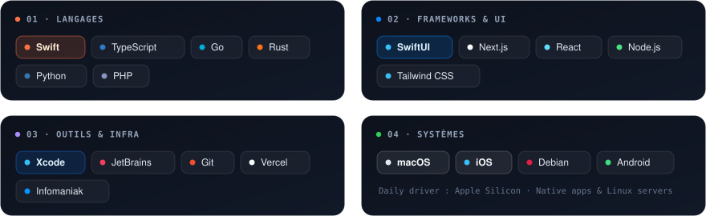

<picture>
  <source media="(prefers-color-scheme: dark)" srcset="./assets/hero-dark.svg">
  <source media="(prefers-color-scheme: light)" srcset="./assets/hero-light.svg">
  
</picture>

  

<a href="https://besty.fr">
  <picture>
    <source media="(prefers-color-scheme: dark)" srcset="./assets/btn-blog-dark.svg">
    <source media="(prefers-color-scheme: light)" srcset="./assets/btn-blog-light.svg">
    
  </picture>
</a>
&nbsp;&nbsp;
<a href="https://x.com/Besty_boy23">
  <picture>
    <source media="(prefers-color-scheme: dark)" srcset="./assets/btn-x-dark.svg">
    <source media="(prefers-color-scheme: light)" srcset="./assets/btn-x-light.svg">
    
  </picture>
</a>
&nbsp;&nbsp;
<a href="https://mysetup.besty.fr/besty">
  <picture>
    <source media="(prefers-color-scheme: dark)" srcset="./assets/btn-setup-dark.svg">
    <source media="(prefers-color-scheme: light)" srcset="./assets/btn-setup-light.svg">
    
  </picture>
</a>

  

### Projets récents

<table>
  <tr>
    <td width="50%" valign="top">
      <a href="https://github.com/besty-boy/swifty-stats"><strong>swifty-stats</strong></a> &nbsp;<code>Swift</code> 
      Moniteur système macOS ultra-compact pour la barre des menus — AppKit, Mach &amp; AppleSMC (~13 Mo RAM).
    </td>
    <td width="50%" valign="top">
      <a href="https://github.com/besty-boy/waves"><strong>waves</strong></a> &nbsp;<code>Swift</code> 
      Application native offline-first de rédaction Markdown &amp; mind-mapping (macOS, iOS, iPadOS) avec serveur MCP local.
    </td>
  </tr>
  <tr>
    <td width="50%" valign="top">
      <a href="https://github.com/besty-boy/agent-rpc"><strong>agent-rpc</strong></a> &nbsp;<code>TypeScript</code> 
      Daemon universel Discord Rich Presence pour plus de 30 agents IA de code (Claude Code, Codex, Cursor, T3 Code…).
    </td>
    <td width="50%" valign="top">
      <a href="https://github.com/besty-boy/cinevauban"><strong>cinevauban</strong></a> &nbsp;<code>Swift</code> 
      App macOS native pour consulter le programme du cinéma Le Vauban à Saint-Malo sans subir le site officiel.
    </td>
  </tr>
</table>

 

### Stack & environnement

<picture>
  <source media="(prefers-color-scheme: dark)" srcset="./assets/stack-dark.svg">
  <source media="(prefers-color-scheme: light)" srcset="./assets/stack-light.svg">
  
</picture>

  

<picture>
  <source media="(prefers-color-scheme: dark)" srcset="./assets/footer-dark.svg">
  <source media="(prefers-color-scheme: light)" srcset="./assets/footer-light.svg">
  
</picture>

